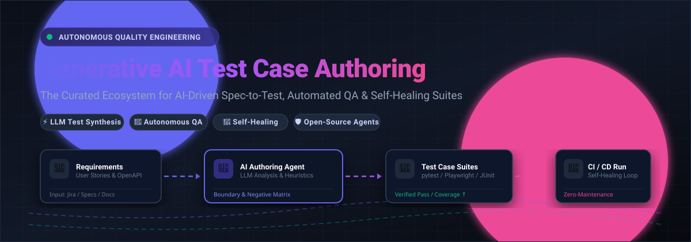
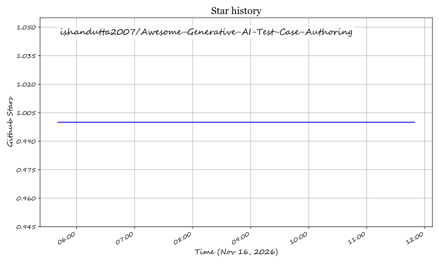

# Awesome Generative AI Test Case Authoring 🧪🤖

  

  
  
  
  
  
  

---

## 🌟 Overview & Ecosystem Guide

Welcome to the definitive, community-curated collection of **Generative AI Test Case Authoring** platforms, autonomous QA agents, and LLM-assisted testing tools. 

Whether you are seeking enterprise-grade SaaS platforms that transform user stories, Jira tickets, or OpenAPI specifications into automated test suites, or open-source test generation engines for self-hosted data sovereignty, this repository tracks the leading tools reshaping modern quality engineering.

### 🎯 Key Capabilities Tracked
* 📝 **Requirements-to-Test Synthesis:** Transforming PRDs, agile tickets, and Gherkin specs into executable tests.
* 🤖 **Autonomous Test Generation Agents:** Multi-agent LLM pipelines generating unit, integration, and API test suites.
* 🔄 **Self-Healing Automation:** Dynamic UI locator repair and runtime assertion maintenance without human intervention.
* 🛡️ **Self-Hosted / Open-Source Engines:** Community frameworks ensuring strict data security and local model deployment.

---

## 📑 Table of Contents
- [📊 Sector Overview & Market Dynamics](#-sector-overview--market-dynamics)
- [☁️ SaaS & Hosted Platforms](#️-saas--hosted-platforms)
- [💻 Open-Source GitHub Projects](#-open-source-github-projects)
- [🤝 How to Contribute](#-how-to-contribute)
- [💖 Support & Sponsorship](#-support--sponsorship)
- [📈 Star History](#-star-history)
- [⚠️ Disclaimer](#️-disclaimer)

---

## 📊 Sector Overview & Market Dynamics

The global AI-powered software testing and test automation market is estimated at **$1.5B to $4.5B** (part of the broader $12B+ AI quality engineering space) and is expanding at an estimated **20%–27% CAGR**. Market dynamics are currently **moderately fragmented transitioning toward consolidation**: while a wave of fast-moving AI-native startups and open-source agents drive rapid innovation at the point-solution tier, established enterprise testing suites (e.g., Tricentis, BrowserStack) are aggressively acquiring or embedding agentic AI authoring tools into their broader platforms rather than seeing a single winner-take-all monopoly emerge.

---

## ☁️ SaaS & Hosted Platforms

*Enterprise SaaS platforms ordered descending by company scale (Valuation / Revenue).*

| Product | Company Scale (Valuation / Revenue) | Pricing (Starting) | Free Tier / Trial Limits | Description |
|:---|:---|:---|:---|:---|
| **[Testim Copilot](https://www.testim.io/blog/tricentis-testim-copilot-announcement/)** | **~$4.5B valuation** (Tricentis GTCR round) / **~$500M ARR** | Paid plans start at **$450/month** (entry parallelization tiers; quote-based annual enterprise packages) | **Free Community tier** (up to 1,000 runs/mo, single-run serialization); **14-day free trial** of full platform | **Generative AI add-on for Testim.** **Generate**: produces custom test steps from text descriptions. **Explain**: clarifies any JavaScript code. **Fix**: analyzes code and suggests corrections for debugging. Integrates directly into Testim test editor—no external tools needed. |
| **[BrowserStack AI Test Case Generator Agent](https://www.browserstack.com/)** | **$4.0B valuation** (Series B) / **~$225M–$300M+ revenue** | Paid plans start at **$29/user/month** (Live billed annually, or $39/mo monthly); Automate plans start at **$59/month** (annual) | **Free Trial**: 30 mins manual live testing, 100 mins automated cross-browser testing; Percy free tier includes **5,000 screenshots/month** | AI agent within BrowserStack for generating test cases and test automation workflows directly integrated into BrowserStack's cross-browser and mobile cloud infrastructure. |
| **[Katalon Studio AI](https://docs.katalon.com/katalon-studio/create-test-cases/generate-api-tests-with-ai-beta)** | **$30M total funding** / **~$36M estimated ARR** | Paid plans start at **$150/user/month** (Premium/Professional, billed annually at $1,800/yr) | **Katalon Free Plan** (perpetual free tier for local test authoring and execution); **30-day free trial** of Studio Enterprise & TestOps | **AI agent generates and runs API tests directly from OpenAPI specifications.** Import spec (URL or file), select test types (Positive, Negative, Security, Edge Case), API paths, and HTTP methods. **Generates tests, runs them, and reports results** with compliance scores and AI-detected issues. **Save as Katalon test cases** for ongoing use. |
| **[Functionize](https://www.functionize.com/blog/functionize-raises-41m-series-b-to-accelerate-the-future-of-autonomous-quality-assurance)** | **$67M total funding** ($41M Series B) / **~$17.3M estimated ARR** | Growth plan starts at **$20/month** (includes 3.2M credits/month); Scale plan at $100/month | **Perpetual Free tier**: $0/mo with **800,000 credits/month** (no time limit) to create and run initial test cases | **Agentic AI platform for autonomous test creation, execution, and maintenance.** AI agents generate, execute, diagnose, and **self-heal** test cases with minimal human input. Claims **90% reduction in test maintenance** and **10x productivity gains**. **1B+ agentic AI actions** run in 2024. |
| **[testRigor](https://testrigor.com/how-to-articles/how-to-use-ai-effectively-in-qa/)** | **$5.1M total funding** (Seed/YC) / **~$15M estimated ARR** | Private plans start at **$1,800/month** (infrastructure-based, unlimited user seats and test runs) | **Perpetual Free Public tier** (unlimited tests/runs, but all test cases and results are public/open-source); custom private trials available upon request | **AI test generation from plain English and visual context.** Upload wireframes/screenshots with written descriptions; AI generates test steps and reusable rules. **Application Description setting** is critical—must describe what the app does, not example scripts, or AI derails. **Iterative steering**: if AI gets stuck, manually add steps then continue generation. |
| **[Qase AI](https://docs.qase.io/en/articles/14442830-ai-in-qase)** | **$9M total funding** (Series A) / **~$4.7M estimated ARR** | Paid plans start at **$35/user/month** (Teams, billed annually with 5-seat minimum, or $42/user/mo monthly) | **Perpetual Free tier** for up to 4 users, 5,000 API results/month (excludes AI); **14-day free trial** of Teams tier with AIDEN AI credits (2,000 credits/mo on paid Teams) | **The most complete AI suite embedded in a test management platform.** **AIDEN Test Designer** generates manual test cases from requirements or linked Jira/GitHub issues. Additional capabilities: scores automation readiness, converts manual tests to automated scripts, exports to Playwright/Cypress/Selenium, and runs tests in Qase's cloud. All AI actions consume credits from a monthly pool. |
| **[Testmo AI](https://www.testmo.com/blog/introducing-ai-test-case-generation-in-testmo-beta/)** | **Acquired / Backed by Sembi** (bootstrapped to 1,000+ customers) | Team plan starts at **$99/month** (flat rate for up to 10 users; 15% discount billed annually) | **21-day free trial** with full access to test management and AI generation; no perpetual free tier (requires paid plan after trial) | **AI Test Case Generation (Beta) available to all Testmo users across all plans.** Generates structured, reviewable test cases directly from requirements with **human-in-the-loop review**—AI suggests, you edit/refine/deselect, then generate final cases in Text, Steps, or BDD format. **Traceability by default**: generated cases are tagged as AI-generated and linked back to originating requirements. |
| **[QF-Test 11](https://www.qftest.com/fr/entreprise/nouvelles/newsletter/qf-test-11-now-available-generate-test-cases-with-ai-securely-and-efficiently.html)** | **Acquired by mgm technology partners** / Private GmbH (~25 employees, 1,400+ clients) | Subscriptions start at **€60/month (~$65/mo)** for Runtime license (annual billing); full authoring Developer licenses from ~€2,000+ or quote | **4-week (28-day) free trial** with fully functional evaluation license file upon request; free download allows tutorial evaluation | **"Bring your own model" AI test generation for UI automation.** Describe what to test—the built-in AI agent **inspects your application live** and delivers a ready-to-run test case draft within minutes. **AI Instruction nodes** embed plain-language instructions into test runs. **OpenAPI import** generates complete API test suites with CRUD tests. **MCP server** lets external AI agents (Claude Code, GitHub Copilot) control QF-Test. |

---

## 💻 Open-Source GitHub Projects

*Open-source GitHub repositories sorted descending by GitHub Stars_Count.*

| Project | GitHub_Stars | Description |
|:---|:---:|:---|
| **[Keploy](https://github.com/keploy/keploy)** |  | **Autonomous API test case and data mock generation from actual traffic.** Captures network interactions and zero-code eBPF calls to generate comprehensive regression and API test cases along with mocks for databases, gRPC, and third-party services. Integrates into CI/CD pipelines to ensure continuous coverage. |
| **[Cover-Agent / Qodo Cover](https://github.com/qodo-ai/qodo-cover)** |  | **The first open-source implementation of Meta's TestGen-LLM research.** Iteratively generates and validates unit test suites until target coverage metrics are satisfied. Features a 4-component loop: Test Runner, Coverage Parser, Prompt Builder, and AI Caller. Supports OpenAI, Anthropic, and 100+ LLMs via LiteLLM. |
| **[Pynguin](https://github.com/se2p/pynguin)** |  | **Automated unit test generation framework for Python.** Leverages search-based software testing (SBST) and evolutionary algorithms (DynaMOSA, MIO, Whole Test Suite) to automatically synthesize executable pytest suites targeting maximum branch and statement coverage. |
| **[EvoSuite](https://github.com/EvoSuite/evosuite)** |  | **Pioneering search-based software testing tool for Java.** Automatically generates JUnit test suites with high code coverage using genetic algorithms and constraint solving. Employs mutation testing to optimize test assertions and minimize test suite footprint. |
| **[EvoMaster](https://github.com/WebFuzzing/EvoMaster)** |  | **AI-driven evolutionary system-level test generation tool for web APIs.** Generates executable black-box and white-box test cases targeting RESTful APIs, GraphQL, and RPC endpoints. Employs search-based testing with dynamic analysis to expose edge bugs and security flaws. |
| **[ApiCat](https://github.com/apicat/apicat)** |  | **OpenAPI-native API design, documentation, and automated test case generator.** Integrates LLMs directly with OpenAPI definitions to automatically synthesize structured API test scenarios, data models, edge cases, and automated test collections. |

### 🛠️ Specialized Specification & Custom Generators

* **[TestAxiom](https://pypi.org/project/testaxiom/)**: **Deterministic, mathematically grounded test design engine.** Generates provable test cases from requirement strings using Boundary Value Analysis, Equivalence Partitioning, and Pairwise matrices. Best for non-probabilistic, auditable verification where LLM hallucinations cannot be tolerated.
* **[Voylla](https://pypi.org/project/voylla/)**: Scriptable multi-language test generator agent supporting Python, Java, and JavaScript with optional LLM API backends or offline mock modes.

---

## 🤝 How to Contribute

Contributions are welcome and appreciated! To add a new platform or update existing listings:

1. **Fork the Repository** 🍴
2. **Create a Feature Branch** (`git checkout -b feature/add-new-tool`)
3. **Add Entry**: Follow the existing Markdown table format with verified pricing, free tier limits, company scale, and links.
4. **Commit & Push** (`git commit -m "Add ToolName to SaaS/Open-Source table"`)
5. **Open a Pull Request** 🚀

Please ensure all descriptions remain factual, objective, and reference official project documentation.

---

## 💖 Support & Sponsorship

If you find this curated collection helpful for your testing strategy, team, or project, please consider showing your support:

* ⭐ **Star the Repository** on GitHub to help others discover it!
* 🍴 **Fork and Share** with your QA, DevOps, and engineering teams.
* ☕ **Sponsor the Project:** Buy us a coffee and support continued maintenance on the [GitHub Sponsors Dashboard](https://github.com/sponsors/ishandutta2007).

---

## 📈 Star History

---

## ⚠️ Disclaimer

- This repository is a **community-curated guide** intended for research, informational, and educational purposes. Inclusion does not imply official endorsement.
- Generative AI and LLM outputs are inherently probabilistic: always incorporate human-in-the-loop review and verify test suites in sandboxed environments before merging into production pipelines.
- Verify enterprise data handling and compliance policies before feeding proprietary code or requirements into cloud AI endpoints.

---

  <b>Built with ❤️ for QA Engineers, Test Architects, and Automation Leaders.</b>

## ⭐ Star History

<a href="https://star-history.com/#ishandutta2007/Awesome-Generative-AI-Test-Case-Authoring&Timeline" align="center">
  <picture>
    <source media="(prefers-color-scheme: dark)" srcset="assets/ishandutta2007_Awesome-Generative-AI-Test-Case-Authoring_growth.svg">
    
  </picture>
</a>
